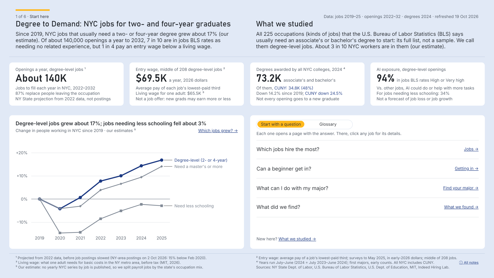
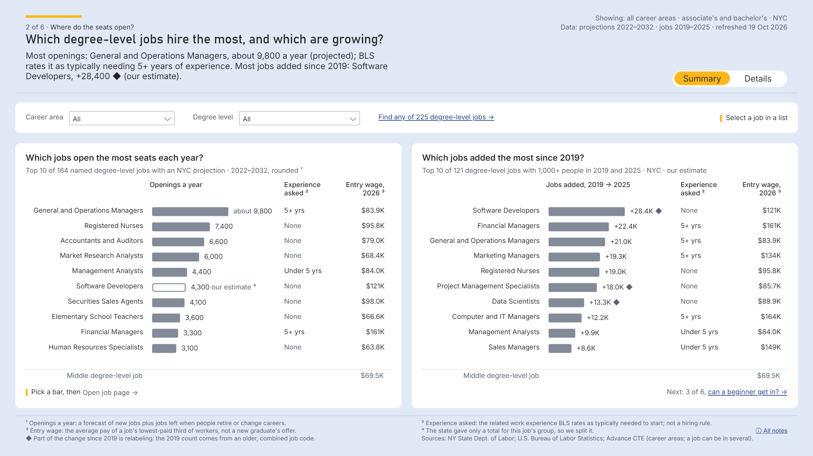
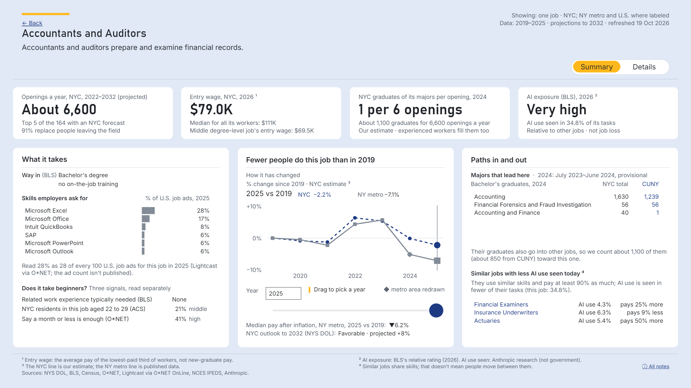
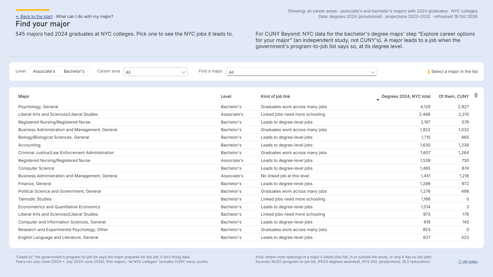
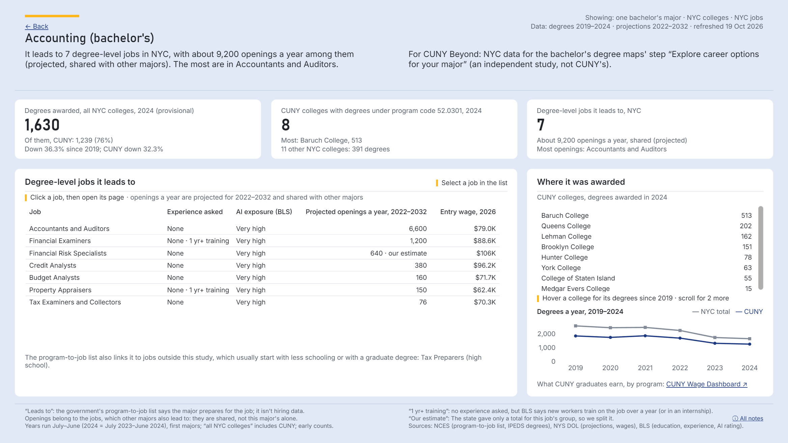
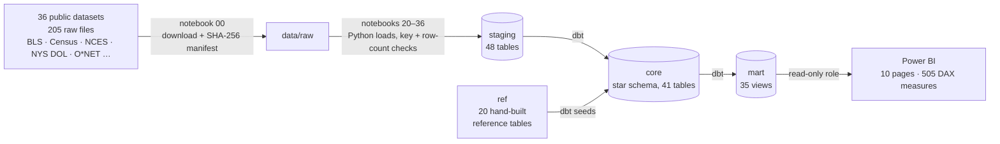

# Degree to Demand: NYC jobs for two- and four-year graduates

**Where do New York City's degree-level jobs open, what do they pay at the start, and which majors lead to them?** This is an end-to-end analytics project on public data. 36 public datasets go through Python and SQL loads into PostgreSQL, then a dbt warehouse with 1,137 tests, then a 10-page Power BI report for CUNY career staff, students and anyone curious about the NYC job market.

**[Open the live report](https://app.powerbi.com/view?r=eyJrIjoiYWUxMjU1OGEtODcwOS00NWU1LTgxNzgtYTYzODNmNDU3OTcxIiwidCI6IjBlZTJlMzg4LWQzNTktNDBmZi1iM2Q0LTVkY2Q1NjI4OTc4NSJ9)** · **[Download the .pbix](powerbi/cuny_degree_demand.pbix)** (opens in the free Power BI Desktop, with the data inside)



**Tools:** Python (pandas, requests, psycopg) · SQL · PostgreSQL 18 · dbt · Power BI (DAX, star schema) · Jupyter · Git

## At a glance

| | |
|---|---|
| **Sources** | 205 raw files from 36 public datasets by 13 publishers. 30 of the datasets come from government agencies (BLS, Census, NCES, NYS Department of Labor, BEA), and every file is logged with its URL, date and SHA-256 |
| **Notebooks** | 38, in three stages: profile each source, load it, analyze the result |
| **Database** | PostgreSQL: 48 staging tables (1.39M rows) → 41 core tables (707K rows) in a star schema → 35 mart views, the only layer the report can read |
| **Transform and test** | dbt: 80 models, 20 reference tables, 1,137 tests, all passing |
| **Report** | Power BI: 10 pages and 505 DAX measures, including a page for each of the 225 jobs and the 545 majors |
| **Report checks** | 291 values on the report pages recomputed from the database: 0 differences. Every job page and every major page checked for errors and blanks: 0 |

## The question

With AI changing the work that degrees lead to, students keep asking whether a college degree is still a path to a good living in New York City. CUNY's career push, CUNY Beyond, aims for every graduate to leave with a job offer or a place in further study, and the staff who advise students need the same answer: *after college, where are the jobs in NYC, and what does it take to get one?* No single source answers that. The answer is spread across federal and state agencies that each use their own codes, years and geography. This project puts those sources together, one job at a time.

**First, which jobs?**

- **What are the 225?** Occupations: kinds of jobs with an official title and code, like Registered Nurses or Accountants and Auditors. They aren't 225 positions. 202 are named jobs and 23 are "all other" groups. About 1.4M people work in them in NYC (2025, my estimate).
- **Who picked them?** No one did by hand. The U.S. Bureau of Labor Statistics (BLS) rates each of its 831 occupations by the schooling it usually takes to start. The 225 are every occupation it rates associate's (48) or bachelor's (177). That's the whole list, not a sample.
- **What's left out?** Jobs that usually start with less schooling (nearly 3 in 4 openings) and jobs that start with a master's or more. Where the report shows them, it's only for comparison.

## What I found

Every number says what kind it is: counted, an agency's estimate, a projection, my estimate, or someone's rating.

1. **Degree-level jobs grew 16.8% from 2019 to 2025 (about +204K people), while jobs at every other entry level, combined, fell 1.7%.** *My estimate, NYC, on the same jobs at both ends.*
2. **About 140K openings a year, and 87% of them come from people leaving a job, not from growth.** A job doesn't have to grow to hire. *NYS DOL projection, 2022–2032.*
3. **69% of those openings are in jobs where BLS lists no prior work experience, but 41% of the jobs added since 2019 ask for five years or more.** *Projection and my estimate; BLS's typical requirement, not a hiring rule.*
4. **NYC colleges awarded 14.2% fewer associate's and bachelor's degrees in 2024 than in 2019; CUNY colleges awarded 24.5% fewer.** *Counted (federal IPEDS completions); 2024 is provisional.*
5. **Median full-time pay is 23% higher with a graduate degree than with a bachelor's alone at ages 35–64, and 11% higher at 22–34.** *Census estimate (ACS 2020–2024), NYC residents.*
6. **94% of degree-level openings are in jobs BLS rates High or Very high for AI exposure, against 34% in jobs that need less schooling.** *BLS's rating is relative to other jobs (August 2026), not a forecast of job loss.*

**A yardstick for pay:** the middle entry wage across the 208 degree-level jobs with one is **$69.5K** (NYS DOL). MIT's living wage for one adult in the NY metro area is **$65.5K** before tax. About 1 in 4 degree-level openings start below that line, and about 4 in 5 associate's-entry openings do.

## What's in the report

| Page | What it answers |
|---|---|
| **Overview** | The headline: openings, entry pay, degrees, AI exposure, and the 2019–2025 trend |
| **Jobs** | Which degree-level jobs hire the most, and which are growing, by career area |
| **Getting in** | How much experience the openings ask for, and what they pay at the start |
| **What we found** | Six findings, each written by a fixed rule from the data, so it would say the opposite if the data did |
| **Find your major** | The 545 majors with 2024 graduates at NYC colleges, searchable by name and level |
| **About this study** | Which jobs, who picked them, how big they are, and the sources with their editions |
| **All jobs A–Z** | Every one of the 225 jobs in one list, with experience asked, AI exposure, projected openings and entry wage |
| **Job page** (225 jobs) | Openings, pay, the majors that lead there, graduates per opening, the skills employers ask for, AI exposure, similar jobs |
| **Major page** (545 majors) | The jobs a major leads to, with openings, experience, AI exposure and entry pay; its degrees at NYC colleges and at each CUNY college since 2019 |
| **Method and notes** | How the data was built, where each kind of number comes from, how reliable the forecasts are, and every footnote |

| | |
|---|---|
|  |  |
|  |  |

## How it's built



- **Profile first, build second.** Before any table was designed, notebooks 01–16 profiled every source: what one row means, the codes, suppressed cells, gaps, and whether it adds up to its own published totals. Each source has a one-page [source card](docs/source-cards/). This is where the biggest problem turned up: the state's official 2022–2032 NYC projections had dropped the detail for software developers, financial analysts and data scientists ([D1](docs/decisions.md)).
- **Load without guessing.** Files are read as text first, so nothing is silently converted. A staging table is saved only if its key is unique and never empty and its row count matches the one documented on its source card; otherwise the notebook stops. The database copy is then tied out to the file copy ([data-pipeline.md](docs/data-pipeline.md)).
- **A warehouse, not a pile of extracts.** dbt builds a `core` star schema: conformed dimensions (`dim_job`, `dim_major`, `dim_college`, `dim_industry`, …), bridge tables for the hard links (major → job, old job codes → new, industry → job), and facts at a stated grain. The business rules live in SQL, where they're tested, not in the report ([schema-design.md](docs/schema-design.md)).
- **A report built for people who aren't analysts.** Power BI imports only the `mart` views, through a role that can't see anything else. Every number on a page answers five questions: what it is, what kind of number, when and where, compared with what, and how sure. Each job and major opens its own drill-through page.

## How it's tested

- **dbt, 1,137 tests, all passing.** Keys and relationships, accepted values, not-null rules, and custom SQL tests that recompute headline numbers from the layer below and pin verified counts. This repository holds 1,135 of them: two tie-outs check figures from a postings provider whose terms don't allow republishing.
- **Loads checked on the way in.** Every staging table needs a unique key and its documented row count, or the load stops. The database copies tie out to the file copies (row counts, column totals, non-null counts).
- **The report against the database.** 291 values shown on the report pages were recomputed from the database and compared with what the report returns: 0 differences.
- **Every page, not a sample.** Every measure on the job page was evaluated for all 225 jobs (0 errors, 0 blanks), and every major page for all 545 majors (0 differences). Every line of text was measured against the width of its box.
- **A claims audit before release.** Every sentence in the report was checked against its source, and the errors found were fixed ([D58](docs/decisions.md)).

## Key decisions

Public data rarely answers the question as asked. A few of the calls that shape what you see (all of them in [decisions.md](docs/decisions.md)):

- **D1, a defect in the state's projections.** I kept every published value, trusted the complete group totals, and filled the broken detail from those totals. Filled jobs say "our estimate."
- **D8, no agency counts NYC workers by job.** I estimate it from NYC industry employment × New York staffing patterns, the method the state uses for its own projections, with the published metro numbers shown as a check.
- **D2 and D20, linking majors to jobs.** The federal crosswalk says what a program prepares for. A degree-level filter keeps jobs a graduate can start in, and a census test flags majors whose graduates spread across many jobs.
- **D45, the five-questions rule for numbers.** Projections are said with "about" and two significant figures, because "642 openings a year" reads like a count when it's a 10-year model average.

## Repository map

| Path | What's there |
|---|---|
| [`notebooks/`](notebooks/) | 00 download · 01–16 profile each source · 20–36 load into `staging` · 40–46 analyze `core` ([index](notebooks/README.md)) |
| [`dbt/`](dbt/) | The warehouse: `core` (dimensions, bridges, facts), `mart` (views for Power BI) and their tests |
| [`ref/`](ref/) | Hand-built reference tables, loaded as dbt seeds (for example, census field of degree → federal program codes) |
| [`sql/`](sql/) | One-time database setup: schemas and the two roles (`pipeline_writer`, `powerbi_reader`) |
| [`src/`](src/) | Shared Python: the source registry and downloader, the staging writer, helpers |
| [`powerbi/`](powerbi/) | The report as a Power BI project (model, relationships, DAX measures, pages) and the `.pbix` |
| [`docs/`](docs/) | Project brief, data pipeline, schema design, key decisions, method, source cards, screenshots ([index](docs/README.md)) |

## Run it yourself

```
1. Python packages       pip install -r requirements.txt   (copy .env.example to .env and set the passwords)
2. Download raw data     notebooks/00-download-data.ipynb  (writes data/raw/ and logs every file in the manifest)
3. Set up the database   psql -U postgres -v writer_pw=... -v reader_pw=... -f sql/00_setup_database.sql
4. Load staging          run notebooks 20 to 36 in order
5. Build and test        cd dbt && dbt build --profiles-dir .
6. Open the report       powerbi/cuny_degree_demand.pbip in Power BI Desktop, then Home → Refresh
```

To look at the report without the database, open `powerbi/cuny_degree_demand.pbix`; the data is inside.

## Limits

- **Projections aren't hiring forecasts.** Openings come from the state's 2022-based projection, a 10-year model average. The state hasn't released its 2024–2034 NYC projection yet.
- **People in each job in NYC is my estimate.** No agency publishes it. Where NYC's mix of jobs within an industry differs from the state's, the estimate is off; small jobs show the published metro line instead.
- **A major-to-job link is a crosswalk, not observed hiring.** A major "leads to" a job when the federal program-to-job list says it prepares for it. Other majors lead to the same jobs, so openings are shared.
- **Entry pay is the state's entry wage** (the average of a job's lowest-paid third of workers), not a new graduate's offer.

## Data sources and credits

Government sources are public domain or open data: the U.S. Bureau of Labor Statistics, the U.S. Census Bureau, NCES (U.S. Department of Education), the U.S. BEA, and the NYS Department of Labor and CUNY Office of Institutional Research via data.ny.gov. Editions are listed on the report's About page and in [`ref/source_registry.csv`](ref/source_registry.csv).

- This report includes information from the O\*NET 31.0 Database and O\*NET OnLine In Demand Software Skills (Lightcast job postings, U.S., 2025) by the U.S. Department of Labor, Employment and Training Administration (USDOL/ETA). Used under the CC BY 4.0 license. O\*NET® is a trademark of USDOL/ETA. I have modified all or some of this information. USDOL/ETA has not approved, endorsed, or tested these modifications.
- Anthropic Economic Index, Labor market impacts of AI (Massenkoff and McCrory, March 2026), CC BY.
- Eloundou, Manning, Mishkin and Rock, GPTs are GPTs (Science, 2024), © 2024 OpenAI, MIT License (notice in [THIRD_PARTY_NOTICES.md](THIRD_PARTY_NOTICES.md)).
- Job postings index: Indeed Hiring Lab, CC BY 4.0.
- Living wage data sourced from the Living Wage Institute via https://livingwage.mit.edu/metros/35620. Accessed on 2026-10-17.
- National Career Clusters® Framework crosswalks, Advance CTE (2024).

Job-postings data from Revelio Labs was used during exploration only. Its terms don't allow republishing, so it isn't in the report or this repository.

The code is MIT-licensed ([LICENSE](LICENSE)); the data stays under each source's terms.

---

Built by **Abel Tshimini**, 2026 · [LinkedIn](https://www.linkedin.com/in/abeltshimini) · [GitHub](https://github.com/AbelT6)
